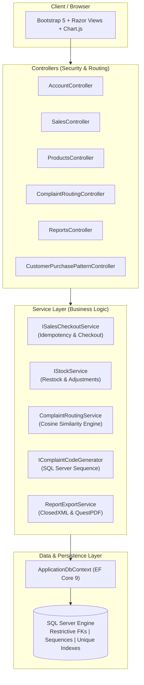

# Retail Sales & Stock Analytics System

A full-featured retail management and analytics platform built with ASP.NET Core 9 MVC, Entity Framework Core 9, and SQL Server. The system provides end-to-end retail operational workflows including sales checkout with idempotency protection, inventory auditing, customer purchase pattern analysis, similarity-based complaint routing, and multi-format business reporting.

---

## 1. Core Modules

### M1 — Sales and Profit Analytics
- **Sales Transaction Management**: Complete order entry, itemized line items, and discount-aware totals.
- **Checkout Idempotency**: Cryptographic token-based acquisition pattern preventing duplicate orders or double-billing during network retries or concurrent submissions.
- **Daily Sales & Revenue Analytics**: Calculation of daily order volume, item quantities sold, revenue, and profit margins.
- **Category Performance Analytics**: Aggregated product performance metrics, revenue contribution, and margin breakdown by product category.
- **Server-Side Pagination**: Efficient `OFFSET ... ROWS FETCH NEXT ... ROWS ONLY` pagination on sales registers for scalable browsing.

### M2 — Stock Movement and Auditing
- **Inventory Tracking**: Real-time stock balance tracking with non-negative inventory enforcement.
- **Audit Logging**: Automated ledger entries in `StockTransactions` recording the transaction type (`Initial`, `Restock`, `Adjustment`, `Sale`, `Edit`), quantities, timestamp, and audit notes.
- **Stock Restocking & Manual Adjustments**: Dedicated manager and admin workflows for inventory replenishment and spoilage/loss adjustments.
- **Historical Record Protection**: Restrictive foreign-key constraints preventing customer or product deletions from silently purging historical inventory movements.

### M3 — Customer Purchase Pattern Analytics
- **Purchase Behavior Analysis**: Customer lifetime order frequency, aggregate spending, average order value, and recency tracking.
- **Product & Category Affinity**: Detailed breakdown of top-purchased categories and items per customer.
- **Interactive Visualizations**: Time-of-day purchase distribution and product volume charts rendered via Chart.js.
- **Customer Profile & Self-Service**: Role-restricted customer views with strict row-level ownership enforcement.

### M4 — AI Complaint Routing
- **Similarity-Based Classification**: Vector-space cosine similarity matching comparing customer complaint text against seeded department category description terms.
- **NLP Preprocessing**: Tokenization, punctuation stripping, and stop-word filtering across domain-specific lexicons.
- **Configurable Routing Thresholds**: Automatic assignment to specialized departments (e.g., Grocery Support, Packaging, Clothing Support) when similarity exceeds thresholds; flags unclassified items for manual review.
- **Concurrency-Safe Sequence Generation**: Lock-free, collision-free complaint code generation (`CMP-XXX`) backed by a dedicated SQL Server sequence (`ComplaintCodeSequence`) and enforced by a database unique index (`IX_Complaints_ComplaintCode`).

### M5 — Reporting and Export
- **Daily Sales Reports**: Filterable date-range sales summaries, order totals, and daily revenue aggregations.
- **Daily Demanding Products Reports**: High-demand item identification tracking volume and revenue per product.
- **Stock Movement Reports**: Chronological inventory audit trail with transaction-type filters and product tracking.
- **Complaint Routing Reports**: Departmental ticket distribution and routing resolution tracking.
- **Multi-Format Document Export**:
  - **Excel Workbooks**: High-fidelity `.xlsx` exports with formatted headers, auto-fit columns, and numeric formatting via **ClosedXML**.
  - **PDF Documents**: Clean, styled document layouts with pagination, tables, and metadata via **QuestPDF**.

---

## 2. Technology Stack

- **Backend Framework**: C# 13, ASP.NET Core 9 (MVC)
- **Data Access & ORM**: Entity Framework Core 9 (SQL Server Provider), Microsoft.Data.SqlClient
- **Database Engine**: Microsoft SQL Server (2019, 2022, SQL Server Express, or LocalDB)
- **Authentication & Security**: ASP.NET Core Identity with hardened password and lockout policies, Anti-Forgery Tokens (`[ValidateAntiForgeryToken]`), Role-Based Access Control (`Admin`, `Manager`, `Customer`)
- **Document Generation**:
  - ClosedXML 0.105.1 (Excel workbook generation)
  - QuestPDF 2026.8.0 (PDF document generation)
- **Frontend & UI**: Razor Views, HTML5, CSS3, JavaScript, Bootstrap 5, Chart.js (interactive client-side charts via CDN)
- **Testing & Quality Assurance**: .NET 9 Test Suite, PowerShell 5.1/7+ HTTP Integration Harness, Live Kestrel Web Server Testing

---

## 3. Architecture & Engineering Highlights



- **Layered Architecture**: Clear separation of concerns between Controllers, ViewModels, Service interfaces/implementations, and EF Core DbContext.
- **Checkout Idempotency**: Protects against double-submits via an atomic distributed token-cache pattern with replacement token logging.
- **Historical Financial & Inventory Preservation**: Foreign-key relationships configured with `DeleteBehavior.Restrict` (`Customer -> Sales`, `Product -> SaleItems`, `Product -> StockTransactions`, `Complaint -> Customer`), preventing cascade deletions from erasing historical records.
- **Concurrency-Safe Sequence Generation**: Replaced row-count calculations with SQL Server `SEQUENCE` and unique indexes, eliminating race conditions during simultaneous complaint creations.
- **Role-Based Authorization & Ownership**: Class-level `[Authorize]` attributes enforce administrative and managerial roles, while row-level checks ensure customers only access their own profile and order data.
- **Narrow Migration Diagnostics**: Application DbContext maintains strict EF Core diagnostics while startup migration execution uses isolated warning suppression for Identity model snapshot compatibility.
- **Portable Configuration Precedence**: Multi-tier configuration loading supporting .NET User Secrets, environment variables, and git-ignored local overrides.

---

## 4. Prerequisites

- **.NET SDK**: .NET 9.0 SDK or later (`dotnet --version` >= 9.0.100).
- **SQL Server**: Microsoft SQL Server 2019/2022, SQL Server Express, or SQL Server LocalDB (`(localdb)\mssqllocaldb`).
- **Operating System**: Windows, Linux, or macOS.
- **PowerShell**: Windows PowerShell 5.1 or PowerShell Core 7+ (required for HTTP integration test suites).

---

## 5. Installation and Setup

### Step 1: Clone the Repository
```bash
git clone https://github.com/Maruff-Ahmed/RetailSales_-_StockAnalytics.git
cd RetailSales_-_StockAnalytics
```

### Step 2: Configure the Database Connection
The tracked `appsettings.json` contains a safe placeholder (`Server=YOUR_SERVER;Database=RetailSalesStockAnalyticsDb;...`). Choose one of the following methods to supply your local connection string:

#### Configuration Priority Order (Highest to Lowest):
1. **Command-Line Arguments**: `--ConnectionStrings:DefaultConnection="..."`
2. **Environment Variables**: `ConnectionStrings__DefaultConnection`
3. **.NET User Secrets** (Development environment only)
4. **Local Configuration File**: `appsettings.Local.json` (git-ignored)
5. **Environment Configuration**: `appsettings.Development.json`
6. **Base Configuration**: `appsettings.json`

#### Option A: Configure Using .NET User Secrets (Recommended for Local Development)
```bash
cd RetailSalesStockAnalytics
dotnet user-secrets set "ConnectionStrings:DefaultConnection" "Server=YOUR_SERVER;Database=RetailSalesStockAnalyticsDb;Trusted_Connection=True;TrustServerCertificate=True"
```
*For SQL Server LocalDB:*
```bash
dotnet user-secrets set "ConnectionStrings:DefaultConnection" "Server=(localdb)\mssqllocaldb;Database=RetailSalesStockAnalyticsDb;Integrated Security=True;TrustServerCertificate=True"
```

#### Option B: Configure Using Environment Variables
**PowerShell:**
```powershell
$env:ConnectionStrings__DefaultConnection = "Server=YOUR_SERVER;Database=RetailSalesStockAnalyticsDb;Trusted_Connection=True;TrustServerCertificate=True"
```
**Bash / macOS / Linux:**
```bash
export ConnectionStrings__DefaultConnection="Server=YOUR_SERVER;Database=RetailSalesStockAnalyticsDb;User Id=YOUR_USER;Password=YOUR_PASSWORD;TrustServerCertificate=True"
```

#### Option C: Configure Using Local JSON (`appsettings.Local.json`)
Create `RetailSalesStockAnalytics/appsettings.Local.json` (excluded by `.gitignore`):
```json
{
  "ConnectionStrings": {
    "DefaultConnection": "Server=YOUR_SERVER;Database=RetailSalesStockAnalyticsDb;Trusted_Connection=True;TrustServerCertificate=True"
  }
}
```

### Step 3: Build the Solution
```bash
dotnet build RetailSalesStockAnalytics.sln
```

### Step 4: Run the Application
The application automatically applies EF Core migrations and seeds initial reference categories and default roles on startup:
```bash
dotnet run --project RetailSalesStockAnalytics/RetailSalesStockAnalytics.csproj
```

The application will listen on `https://localhost:7070` and `http://localhost:5083` (or `http://127.0.0.1:5005` in test harnesses).

---

## 6. Testing & Quality Assurance

The repository includes a comprehensive 3-tier test harness containing **407 automated tests**:

| Test Suite Tier | Scope & Coverage | Tests |
| :--- | :--- | :---: |
| **Unit, Architecture, Security & Metadata** | Token concurrency, Identity policies, lockout, model metadata, config precedence | **55** |
| **C# SQL Server Functional Workflows** | End-to-end sales, inventory audit, sequence concurrency, unique constraint rejection | **28** |
| **HTTP Integration — Sales** | Live Kestrel: Checkout, Idempotency, Details, Pagination, Overposting protection | **67** |
| **HTTP Integration — Product & Stock** | Live Kestrel: CRUD, Adjustments, Restock, Admin restrictions, Audit history | **67** |
| **HTTP Integration — Customer** | Live Kestrel: CRUD, Complaint routing, Role boundaries, Anti-forgery tokens | **82** |
| **HTTP Integration — Reports** | Live Kestrel: Daily sales, Stock movement, PDF & Excel exports, Content verification | **108** |
| **Total Test Count** | **Complete Solution Test Coverage** | **407** |

### Test Database Safety Guard

> [!CAUTION]
> **Primary Database Safety Guard**:
> Functional and HTTP integration tests **strictly require** the dedicated test database `RetailSalesStockAnalytics_TestDb`.
> Any attempt to run functional tests against the primary database (`RetailSalesStockAnalyticsDb`) or an unrecognized database will immediately trigger an explicit security error and terminate with exit code 1.

### Running Test Suites

#### 1. Unit, Security & Architecture Test Suite (In-Memory, No DB Required)
```bash
dotnet run --project RetailSalesStockAnalytics.Tests/RetailSalesStockAnalytics.Tests.csproj --no-build
```

#### 2. C# Functional Test Suite (Requires Approved Test Database)
```powershell
$env:ConnectionStrings__TestConnection = "Server=YOUR_SERVER;Database=RetailSalesStockAnalytics_TestDb;Trusted_Connection=True;TrustServerCertificate=True"
dotnet run --project RetailSalesStockAnalytics.Tests/RetailSalesStockAnalytics.Tests.csproj --no-build -- --functional
```

#### 3. Complete Integrated Test Runner (Functional Workflows + Live HTTP Suites)
```powershell
dotnet run --project RetailSalesStockAnalytics.Tests/RetailSalesStockAnalytics.Tests.csproj --no-build -- --functional --http
```

#### 4. Running Individual PowerShell HTTP Integration Suites
```powershell
# Sales HTTP Integration
powershell -NoProfile -ExecutionPolicy Bypass -File "RetailSalesStockAnalytics.Tests/Test-SalesHttpIntegration.ps1" -Functional -ConnectionString "Server=YOUR_SERVER;Database=RetailSalesStockAnalytics_TestDb;Integrated Security=True;TrustServerCertificate=True"

# Product & Stock HTTP Integration
powershell -NoProfile -ExecutionPolicy Bypass -File "RetailSalesStockAnalytics.Tests/Test-ProductStockHttpIntegration.ps1" -Functional -ConnectionString "Server=YOUR_SERVER;Database=RetailSalesStockAnalytics_TestDb;Integrated Security=True;TrustServerCertificate=True"

# Customer & Complaint HTTP Integration
powershell -NoProfile -ExecutionPolicy Bypass -File "RetailSalesStockAnalytics.Tests/Test-CustomerHttpIntegration.ps1" -Functional -ConnectionString "Server=YOUR_SERVER;Database=RetailSalesStockAnalytics_TestDb;Integrated Security=True;TrustServerCertificate=True"

# Reports & Document Export HTTP Integration
powershell -NoProfile -ExecutionPolicy Bypass -File "RetailSalesStockAnalytics.Tests/Test-ReportsHttpIntegration.ps1" -Functional -ConnectionString "Server=YOUR_SERVER;Database=RetailSalesStockAnalytics_TestDb;Integrated Security=True;TrustServerCertificate=True"
```

---

## 7. Project Structure

```
RetailSalesStockAnalytics/
├── .gitignore                                  # Comprehensive .NET, VS, IDE & Secret exclusions
├── LICENSE                                     # MIT License
├── README.md                                   # System documentation & setup guide
├── RetailSalesStockAnalytics.sln               # Solution file
│
├── RetailSalesStockAnalytics/                  # Web Application Project
│   ├── ConfigurationHelper.cs                  # Configuration provider precedence orchestrator
│   ├── Program.cs                              # Application startup, DI & middleware pipeline
│   ├── Controllers/                            # MVC Controllers (Role-based authorization)
│   ├── Data/                                   # ApplicationDbContext, Seeders, Initializers
│   ├── Migrations/                             # 9 EF Core migrations + Model Snapshot
│   ├── Models/                                 # Domain entities (Customer, Product, Sale, etc.)
│   ├── Services/                               # Business logic, idempotency, routing & export services
│   ├── ViewModels/                             # Strongly-typed presentation view models
│   ├── Views/                                  # Razor views organized by controller
│   └── wwwroot/                                # Client assets (CSS, JS, Bootstrap 5, libraries)
│
└── RetailSalesStockAnalytics.Tests/            # Unified Test Project
    ├── Program.cs                              # 55 Unit/Security/Metadata checks + Runner coordinator
    ├── FunctionalTestSuite.cs                  # 28 SQL Server functional workflows
    ├── Test-SalesHttpIntegration.ps1           # 67 Sales live HTTP integration tests
    ├── Test-ProductStockHttpIntegration.ps1   # 67 Product & stock live HTTP tests
    ├── Test-CustomerHttpIntegration.ps1       # 82 Customer & complaint live HTTP tests
    └── Test-ReportsHttpIntegration.ps1        # 108 Report & export content live HTTP tests
```

---

## 8. License

This project is open-source software licensed under the [MIT License](LICENSE).

---

## 9. Future Enhancements

- **Machine Learning Integration**: Upgrade similarity-based complaint routing to an embedded ONNX runtime or ML.NET text classification model.
- **Distributed Cache Integration**: Replace in-memory token caching with Redis for multi-instance horizontal scaling.
- **Asynchronous Message Queues**: Decouple PDF/Excel export generation via background job processors (e.g., Hangfire / RabbitMQ).
